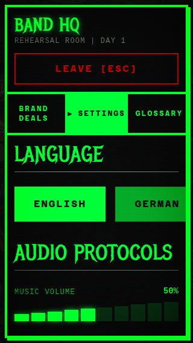
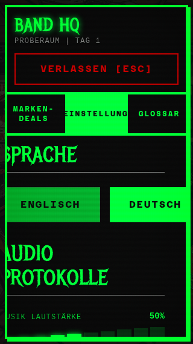
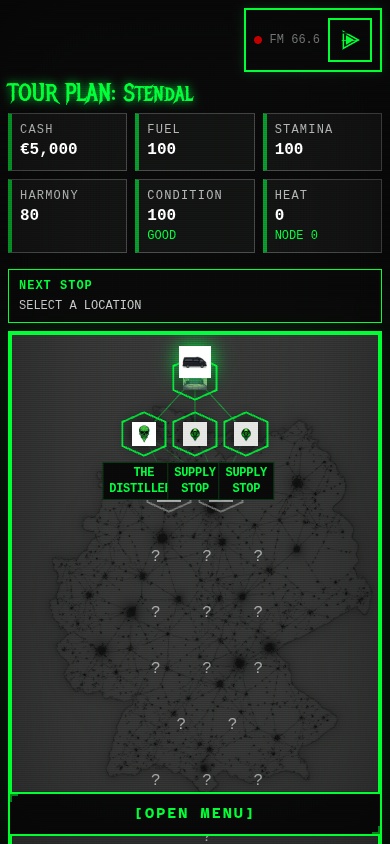
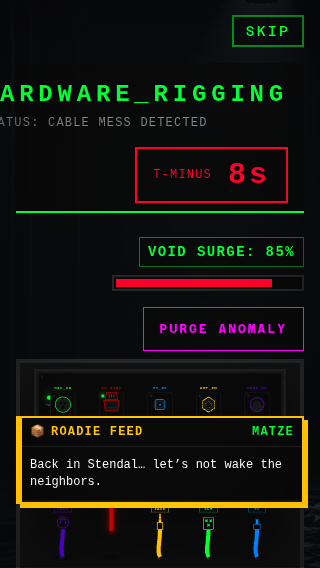
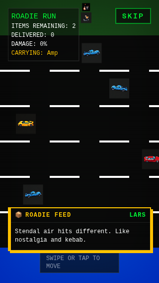

# Visual audit — 24 October 2026

Source: `main` at `50a4f65f7eb2968bd9435753beb7406d4bff0356`.
Capture tool: repository Playwright with system Chromium, local Vite.
Viewports: 1440×900, 390×844, 320×568; additional 844×390 layout check.
Languages: English and targeted German settings/navigation checks.
Normal-motion captures were followed by reduced-motion repeat captures. Screenshots showing scene loading or incomplete entry animations were rejected.

## Verified findings

1. **Settings content clips at 320px.** English language controls exceed their panel; choosing German also shifts/clips content on the left.
2. **German Band HQ tab text escapes its button.** EINSTELLUNGEN and the selected arrow exceed the 104px tab and run into adjacent tabs.
3. **Expedition destination chips overlap at 390px.** On the Home Turf/Standard Tour route with seed 1, The Distillery and Supply stop overlap by approximately 18px.
4. **Kabelsalat heading clips at 320px.** The title starts at x = −19.25px; the status line loses its left edge as well.
5. **Chatter covers gameplay on short phones.** The default fallback can cover the middle of the wiring board and the Roadie playfield when no anchor fits.

Each finding is filed as its own GitHub issue. Main game source was not changed.

## Flow coverage

| Step | Screen / action | Visual health in this pass |
| --- | --- | --- |
| 1 | First-run menu and tutorial | Primary hierarchy renders; tutorial can be dismissed. |
| 2 | Tour Prep, route/setlist | Reflows at 320px and 390px; controls reachable by scrolling. |
| 3 | Tour Prep, cargo/risk/contracts | Tabs and contents render; no page-level horizontal overflow observed. |
| 4 | Expedition map | Finding 3; landscape map is compressed, without an additional independently verified defect. |
| 5 | Action menu | Category counts touch their labels; recorded as a spacing observation, not a separate defect. |
| 6 | Band HQ stats/shop/upgrades/touring | Rendered at desktop and phone sizes; image-loading placeholders alone were not treated as broken artwork. |
| 7 | Band HQ setlist | Long names wrap; no measured metadata/button overlap in this pass. |
| 8 | English settings | Finding 1 at 320px; 390px language buttons fit. |
| 9 | German settings and HQ tabs | Findings 1 and 2. |
| 10 | Pre-gig logistics/setlist | Rendered with fixture gig; no independent blocking visual defect verified. |
| 11 | Roadie / Amp Calibration | Playfield and HUD captured; Roadie chatter contributes to finding 5. |
| 12 | Kabelsalat, including a power connection | Findings 4 and 5. SVG socket targets measured at approximately 24×31px on 320px; small visible art was not reported as an undersized hit target. |
| 13 | Clinic | Header, member treatment cards and leave action rendered; body scrolls on short screens. |
| 14 | Gig report → social strategy | Stable captures render payout and strategies; initial faded animation frames were excluded. |
| 15 | Investments/assets | Header, acquisition card, finance area and bottom tabs rendered. |

## Screenshot evidence

### English settings — 320×568

### German settings and selected tab — 320×568

### Expedition map — seed 1, 390×844

### Kabelsalat — 320×568

### Roadie — 320×568

## Evidence limits

This is a local visual audit, not a production-device certification. Browser rectangles and current screenshots support the findings. It does not establish full screen-reader, contrast, keyboard, hardware-GPU, audio, or real-device accessibility compliance. The complete rhythm gig and every possible event/ending were not visually exercised. Artificially seeded states used the existing DEV hooks, real reducer-backed fixtures and normal UI components; no production saves were used.
